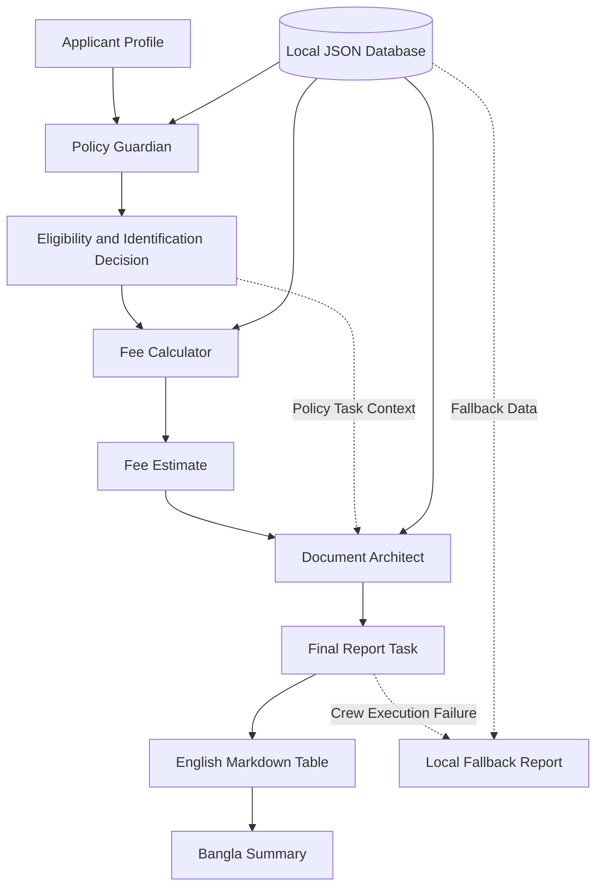

# Amar Passport AI Agent 🇧🇩

A CrewAI-based Multi-Agent System that generates a personalized Bangladesh e-Passport Readiness Report in English and Bangla.

## Features

- **Policy Guardian:** Evaluates age-based passport validity and identification requirements.
- **Fee Calculator:** Estimates passport fees using a local JSON database and the policy decision.
- **Document Architect:** Generates a personalized document checklist.
- **Error Handling:** Flags conflicting requests, such as a 15-year-old requesting a 10-year passport.
- **Local Fallback:** Generates a report from local data when AI execution fails.
- **Bilingual Output:** Provides an English Markdown table and a Bangla summary.

## Technologies Used

- Python 3.13
- CrewAI
- Google Gemini API
- JSON
- python-dotenv

## Project Workflow

The system follows a **sequential multi-agent workflow**. Each task uses the relevant outputs from preceding tasks through CrewAI task context.



### Workflow Steps

1. **Input Collection:** Collect the applicant's age, profession, passport page count, requested validity, delivery type, location, and document details.
2. **Policy Guardian:** Evaluates age-based eligibility, permitted validity, and identification requirements.
3. **Fee Calculator:** Receives the Policy Guardian's Task output as context and estimates the fee using the local JSON database.
4. **Document Architect:** Receives both the Policy Guardian's and Fee Calculator's Task outputs as context and prepares a personalized checklist.
5. **Final Report:** The final Task uses the previous Task outputs to generate an English Markdown table followed by a Bangla summary.
6. **Local Fallback:** If CrewAI execution raises an exception, the program generates a report directly from local database data.

## Project Structure

```text
amar-passport/
├── agents/
│   ├── policy_guardian.py
│   ├── fee_calculator.py
│   └── document_architect.py
├── tasks/
│   ├── policy_task.py
│   ├── fee_task.py
│   └── document_task.py
├── config/
│   ├── llm.py
│   └── passport_data.json
├── tools/
├── main.py
├── .env
├── .gitignore
└── README.md
```

## Setup

Activate the existing Python environment in WSL:

```bash
source ~/amar-passport-env313/bin/activate
```

Navigate to the project directory:

```bash
cd /mnt/d/AI/ai/amar-passport
```

Install the dependencies if needed:

```bash
uv pip install "crewai[google-genai]" python-dotenv
```

Configure the `.env` file:

```dotenv
GEMINI_API_KEY=your_gemini_api_key
MODEL=gemini/gemini-3.5-flash-lite
```

Keep your API key private and never upload `.env` to GitHub.

## Run the Project

```bash
python main.py
```

Enter the applicant's details when prompted. The system runs the agents sequentially and generates the readiness report.

## Example Use Cases

- Checking a minor's requested passport validity.
- Estimating fees by page count, validity, and delivery speed.
- Preparing a personalized document checklist.
- Generating a fallback report when AI execution fails.

## Important Notice

The fee and policy values in `config/passport_data.json` are assignment-provided sample data. Verify them against current official Bangladesh Department of Immigration and Passports (DIP) guidance before practical use.

## Disclaimer

This project provides AI-assisted passport application guidance based on official policy sources. Its accuracy depends on the correctness and freshness of the underlying data. Users should verify the latest requirements through the official Bangladesh e-Passport Portal before submitting an application.